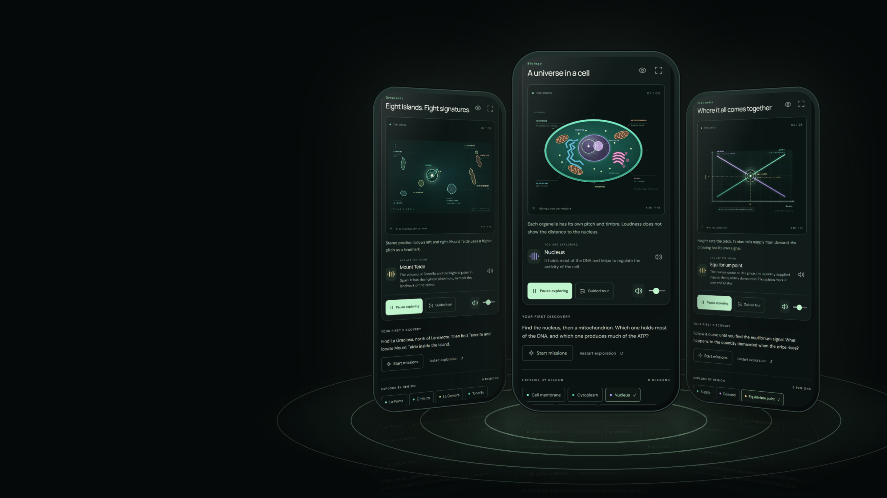
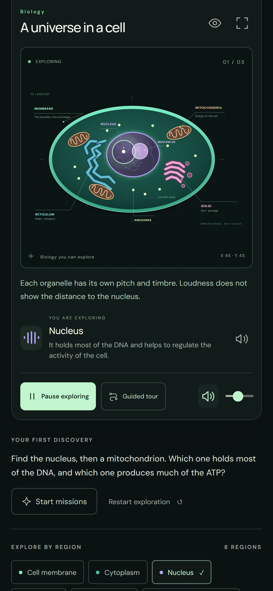
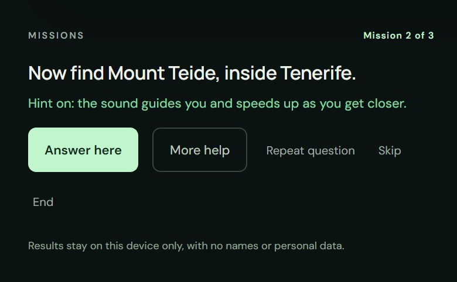
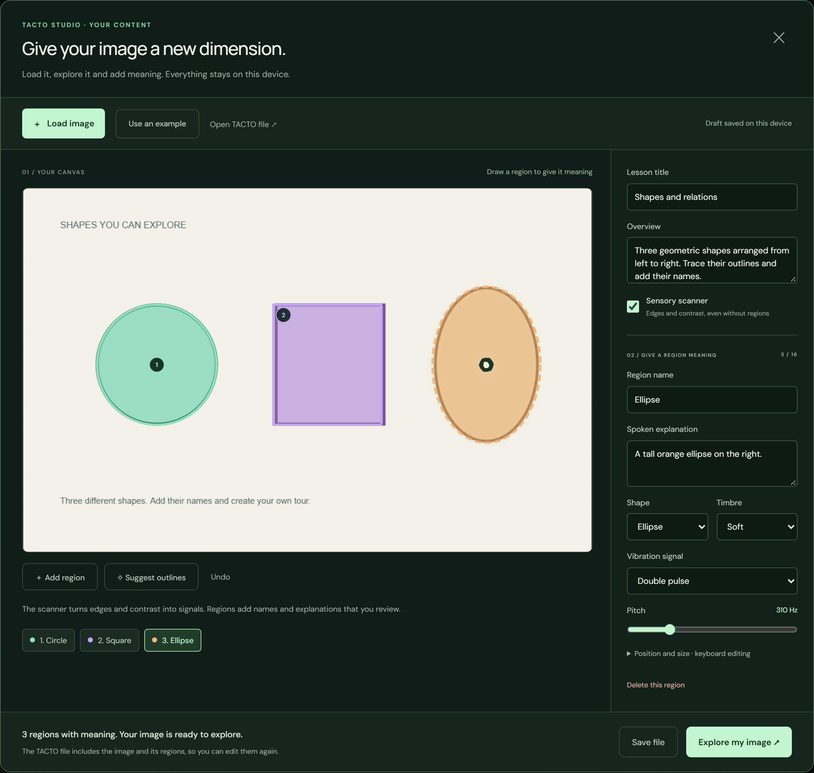

# TACTO · diagrams you can touch and hear



In class, a diagram can reach a blind student as a single sentence: “diagram of a cell”. **TACTO** lets blind and low-vision students explore the diagram itself, with one finger, on the phone they already own. Every region answers with its own tone, a spoken name and a vibration.

- **Live demo:** <https://enrickq.github.io/tacto/> (headphones recommended; the ES · EN switch at the top changes the language)
- **90-second video:** <https://youtu.be/Cdt1AGSOTkM>
- **ERUA iDeaThon 2026:** challenge 3.2, *Disability inclusion and accessibility*

## What it does

**Explore.** Three lessons: a cell, the eight Canary Islands, and supply and demand. Each region has its own pitch, timbre and stereo position, a spoken name and explanation, and a vibration pattern on Android. “Inside” and “next to” become something you can hear: inside Tenerife, Mount Teide has a higher tone.

**Check.** Missions (“Now find Mount Teide, inside Tenerife”) are answered with a double tap. Help comes in steps: a guiding sound that speeds up as the finger gets closer, then spoken directions. Each result records whether the answer was found, the help used and the time taken. It stays on the device, with no names.

**Create.** In TACTO Studio, a teacher loads any image, marks its regions, names and explains them, and shares the lesson as one small open file (`.tacto.json`).

| Exploring on a phone | A mission | TACTO Studio |
| --- | --- | --- |
|  |  |  |

It runs in Spanish and English, offline once loaded. There are no accounts, no servers and no analytics.

## Run it

You need Node.js 20 or newer. There are no packages to install.

```bash
npm run dev     # http://localhost:4317
npm test        # 102 automated tests
npm run check   # syntax and resources
```

## Android

`android-app/` is a light WebView wrapper with a native bridge to the vibration motor. Its only permission is `VIBRATE`.
- **Build:** on Windows, run `android-app\build.ps1`. The first build downloads a portable JDK and Android build tools and checks them against fixed hashes.
- **Signing:** the build signs the APK with a throwaway local test key that it creates itself. It is not a release key, and no key is in this repository.

Details are in [android-app/README.md](android-app/README.md), in Spanish.

## Recorded narration

The app speaks with the voices of the browser or the phone. It can also play recorded narrations, which sound the same on every device. Those recordings are not in this repository, because they are made with the voices installed in Windows. To generate them on Windows:

```bash
node scripts/prepare-narration.mjs
powershell.exe -NoProfile -File scripts/generate-narration.ps1
```

## Honest limits

- The screen stays flat. Vibration is a signal, not relief.
- TACTO has not yet been tested with blind or low-vision students. A co-design pilot in the Canary Islands is the next step.
- TACTO complements braille, tactile graphics and human support. It does not replace them.

## Project layout

| Folder | What is in it |
| --- | --- |
| `dist/` | The app: static ES modules, no build step |
| `tests/` | Automated tests (`node --test`) |
| `scripts/` | Checks, screenshots and the narration tools |
| `android-app/` | The Android wrapper |
| `docs/images/` | The pictures in this README |

## Research behind it

- Gorlewicz et al. (2020). Design guidelines and recommendations for multimodal, touchscreen-based graphics. *ACM Transactions on Accessible Computing*, 13(3).
- Tennison et al. (2023). *Journal of Visual Impairment & Blindness*, 117(6). [doi:10.1177/0145482X231217496](https://doi.org/10.1177/0145482X231217496)
- Butler, Holloway, Marriott and Goncu (2017). Understanding the graphical challenges faced by vision-impaired students in Australian universities. *Higher Education Research & Development*. [doi:10.1080/07294360.2016.1177001](https://doi.org/10.1080/07294360.2016.1177001)

## Author

Enrique Fernández García, a Computer Engineering student at the University of Las Palmas de Gran Canaria, designed and built TACTO.

## Licence

TACTO is released under the [European Union Public Licence 1.2](LICENSE) (EUPL-1.2). Lessons you make with TACTO Studio are yours.
